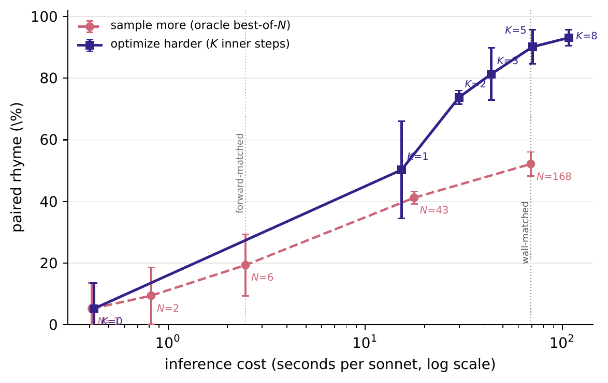

# Supplementary material

Supplement to "SonnetDiffusion: Training-Free Analytic Control for Formal Constraints in Diffusion
Poetry Generation". "Section N" refers to the paper. A subset of generated sonnets with their scores
is in [`best_sonnets.md`](best_sonnets.md).

Contents:

1. [Compute sweeps](#1-compute-sweeps) (Tables S1-S2, Figure S1)
2. [Weight sweeps](#2-weight-sweeps) (Table S3)
3. [Concept and emotion penalties](#3-concept-and-emotion-penalties) (Table S4)
4. [Fluency evaluation details](#4-fluency-evaluation-details) (Tables S5-S6)
5. [Full penalty definitions](#5-full-penalty-definitions) (Table S7)
6. [Baseline prompt](#6-baseline-prompt)
7. [Control mechanisms for text diffusion](#7-control-mechanisms-for-text-diffusion) (Table S8)
8. [Data and model licenses](#8-data-and-model-licenses)

Unless stated otherwise: three seeds (102, 202, 302), 30 sonnets per seed, mean ± half-width of the
95% interval over seeds.

## 1. Compute sweeps

These support the inner-step and best-of-N results of Section 6.

**Table S1.** Inner-step budget K. K = 0 is the measured no-control point.

| | K=0 | K=1 | K=2 | K=3 | **K=5** | K=8 |
|---|---|---|---|---|---|---|
| Forward passes | 100 | 190 | 280 | 370 | 550 | 820 |
| Seconds per sonnet | 0.42 | 15.27 | 29.93 | 43.62 | 70.25 | 107.97 |
| Rhyme % | 5.2 ± 8.4 | 50.2 ± 15.8 | 73.8 ± 2.2 | 81.3 ± 8.5 | **90.1 ± 5.5** | 93.1 ± 2.6 |
| Distinct end words % | 99.0 ± 0.0 | 92.6 ± 7.8 | 90.2 ± 6.4 | 88.7 ± 2.9 | 83.0 ± 8.7 | 78.6 ± 2.8 |

Forward passes are exactly 100 + 90K: the controller runs on 90 of the 100 respaced steps. The K = 5 time is the measurement used for compute matching (`best_of_n_results.json`); the sweep's own run measured 70.58 s.

**Table S2.** Oracle best-of-N. All N are drawn from one pooled set of uncontrolled samples per seed,
so smaller N are nested inside larger ones and the columns are not independent. Selection uses the
full-scheme rhyme metric. The N = 168 row of Table 1 in the paper gives its intervals.

| | N=1 | N=2 | N=6 | N=43 | N=168 | Gradient control (K=5) |
|---|---|---|---|---|---|---|
| Seconds per sonnet | 0.41 | 0.82 | 2.47 | 17.72 | 69.24 | 70.25 |
| Rhyme, full scheme % | 5.2 | 9.4 | 19.3 | 41.2 | 52.1 | **90.1** |
| Rhyme, quatrains only % | 5.5 | 10.2 | 21.8 | 48.6 | 60.7 | **90.4** |
| Distinct end words % | 99.0 | 98.1 | 97.0 | 93.5 | 92.6 | 83.0 |

**Figure S1.** Oracle best-of-N (circles) and inner-step control (squares) against wall-clock time.
The oracle selects with the full rhyme metric and sees only a scalar score per candidate; the
controller differentiates through the constraint. Vertical marks show the forward-pass-matched and
wall-clock-matched budgets.

## 2. Weight sweeps

**Table S3.** One weight varied at a time, all others at their default. Starred rows are the default
values used in every other experiment; we report the whole curve rather than selecting the best row.

| Weight | Rhyme % | Meter % | Distinct end words % |
|---|---|---|---|
| λ_rep = 0.2 * | 90.1 ± 5.5 | 63.6 ± 6.4 | 83.0 ± 8.7 |
| λ_rep = 1.0 | 88.5 ± 10.3 | 64.0 ± 1.8 | 90.2 ± 4.6 |
| λ_rep = 5.0 | 87.1 ± 6.3 | 62.2 ± 1.4 | 91.2 ± 3.3 |
| λ_rhyme = 0.1 | 65.4 ± 11.0 | 61.7 ± 3.3 | 93.0 ± 4.9 |
| λ_rhyme = 0.25 | 82.7 ± 4.3 | 61.3 ± 5.5 | 86.5 ± 5.6 |
| λ_rhyme = 0.5 * | 90.1 ± 5.5 | 63.6 ± 6.4 | 83.0 ± 8.7 |
| λ_rhyme = 1.0 | 93.7 ± 2.5 | 63.1 ± 11.6 | 79.1 ± 3.3 |
| λ_rhyme = 2.0 | 94.0 ± 5.5 | 63.3 ± 10.1 | 76.6 ± 8.7 |

## 3. Concept and emotion penalties

Two of the six penalties do not act on form. They push each sonnet to contain at least one word from
a fixed list:

- **Concept** (weight 2 per word): *pájaro, ave, ruiseñor, azul, pecado*.
- **Emotion** (uniform weight): *alegría, gozo, dicha, risa, júbilo, contento, fiesta, deleite,
  placer, dulzura, encanto, feliz, dichoso, gozoso, radiante, celebrar, cantar, danzar, reír*.

No metric in the paper scores them. Table S4 reports how often the lists appear.

**Table S4.** Share of sonnets (%, n = 90 per configuration) containing at least one word of each list.

| | No control | K=2 | K=5 | K=5 + repulsion |
|---|---|---|---|---|
| Concept list | 8.9 | 90.0 | 76.7 | 90.0 |
| Emotion list | 17.8 | 100.0 | 100.0 | 100.0 |

## 4. Fluency evaluation details

These are the numbers behind Section 7 (Fluency). The judge is Gemma-4-31B-it at temperature 0.
Sample *i* of system X is compared with sample *i* of system Y from the same seed, in both
presentation orders. Each criterion is answered A, B or tie, and a tie counts one half.

**Table S5.** Pairwise preference for X. n is the number of poem pairs; each pair is judged twice, once
per order. Brackets give Wilson 95% intervals over pairs. Position consistency is the share of pairs
that receive the same verdict in both orders, averaged over the three criteria. The last column
splits the judgments by whether X is the more repetitive poem of the pair; the number of judgments is
in parentheses.

| X vs Y | n | Grammaticality | Coherence | Poetic quality | Position consistency | X more / less repetitive |
|---|---|---|---|---|---|---|
| K=5 vs no control | 90 | 0.86 [0.77, 0.91] | 0.86 [0.77, 0.92] | 0.85 [0.76, 0.91] | 0.84 | 0.87 (172) / 0.54 (8) |
| K=5 vs best-of-168 | 90 | 0.79 [0.69, 0.86] | 0.78 [0.69, 0.86] | 0.78 [0.68, 0.85] | 0.81 | 0.79 (154) / 0.74 (26) |
| Best-of-168 vs no control | 90 | 0.69 [0.59, 0.78] | 0.69 [0.59, 0.78] | 0.68 [0.58, 0.77] | 0.77 | 0.71 (118) / 0.63 (62) |
| K=5, CDC DCD vs no control | 90 | 0.88 [0.80, 0.93] | 0.89 [0.80, 0.94] | 0.88 [0.79, 0.93] | 0.87 | 0.89 (176) / 0.50 (4) |
| K=5 + repulsion vs no control | 15 | 0.90 [0.66, 0.98] | 0.89 [0.65, 0.97] | 0.89 [0.65, 0.97] | 1.00 | 0.94 (27) / 0.33 (3) |
| K=5 + repulsion vs K=5 | 15 | 0.62 [0.37, 0.81] | 0.64 [0.39, 0.83] | 0.60 [0.36, 0.80] | 0.33 | 0.49 (12) / 0.69 (18) |

**Table S6.** Difference in per-poem log perplexity against no control, raw and adjusted for
within-poem repetition by a linear term. The slope is the change in log perplexity per unit of
repetition rate. Negative values favor the listed system.

| Scorer | System | Raw Δ | Adjusted Δ (95% CI) | Repetition slope |
|---|---|---|---|---|
| Salamandra-7B | Best-of-168 | -0.178 | -0.114 ± 0.054 | -2.51 |
| Salamandra-7B | K=5 | -0.546 | -0.164 ± 0.077 | -3.23 |
| Salamandra-7B | K=5, CDC DCD | -0.654 | -0.225 ± 0.086 | -3.29 |
| Gemma-4-12B | Best-of-168 | -0.195 | -0.129 ± 0.055 | -2.56 |
| Gemma-4-12B | K=5 | -0.642 | -0.308 ± 0.080 | -2.82 |
| Gemma-4-12B | K=5, CDC DCD | -0.750 | -0.346 ± 0.085 | -3.09 |

## 5. Full penalty definitions

All six penalties are evaluated on p = softmax(Logits(x̂₀(c_t)) / τ) with τ = 0.8, where p_{b,ℓ,v} is
the probability of vocabulary item v at position ℓ of sample b. Line-final positions are located on
the current hard decoding of x̂₀. For each of the first fourteen verse separators, the position is the
last word with a rhyme suffix among the six tokens before that separator, skipping function words.
Section 3 of the paper gives the rhyme and syllable penalties; the other four are defined below.

The weights used in every experiment are:

- λ_rhyme = 0.5, λ_rep = 0.2, λ_concept = 0.15, λ_emotion = 0.15, λ_fmt = λ_syll = 0.05
- λ_anchor = 5 × 10⁻⁴, inner step size 0.03

**Rhyme suffixes.** The matrix S is built once, before sampling, by applying a rule to every
vocabulary item, so no rhyme annotation is involved at any point. A syllabifier returns a word's
syllables and the index of the stressed one. The suffix is that syllable from its vowel nucleus
onward, followed by every later syllable, with accents stripped.

Locating the nucleus inside the stressed syllable is the only step that needs its own rule. The
nucleus is the first accented vowel; failing that, the first open vowel (*a*, *e*, *o*); failing
that, the last weak vowel (*i*, *u*, *ü*). The last case excludes the glide of a rising diphthong,
so that *tierra* rhymes on `erra` rather than `ierra`. Words with no vowel, and the seven special
tokens, receive no suffix and are left as zero rows in S.

**Table S7.** The suffix rule on eight vocabulary items. Stress position decides where the suffix
begins, which is why *canto* and *cantó* fall in different classes although they share every letter.

| Word | Syllables | Stressed syllable | Suffix |
|---|---|---|---|
| *canto* | can-to | *can* | `anto` |
| *encanto* | en-can-to | *can* | `anto` |
| *cantó* | can-tó | *tó* | `o` |
| *santo* | san-to | *san* | `anto` |
| *día* | dí-a | *dí* | `ia` |
| *fría* | frí-a | *frí* | `ia` |
| *amor* | a-mor | *mor* | `or` |
| *ruiseñor* | rui-se-ñor | *ñor* | `or` |

Words in one class rhyme by construction. Over the 23,001-item vocabulary the rule produces
3,413 classes covering 22,957 tokens. The largest classes are `ado` (685 words), `ar` (577) and
`o` (546). The rhyme penalty pushes two line-final positions toward the same column of S.

**Format.** Let s_b = Σ_ℓ p_{b,ℓ,eos} be the soft count of verse separators in sample b. The penalty
is (1/B) Σ_b ((s_b − 14)/14)², normalized by the target so that it stays of order one.

**Repetition.** For line-final positions i, j inside a rhyme group, with word-level distributions
p_i and p_j, the penalty measures overlap as (p_i · p_j)². It is averaged over the same pairs the rhyme
penalty uses. It enters the objective with the opposite sign: rhyme pulls the suffixes of line-final
words together, and repetition pushes the words themselves apart.

**Concept and emotion.** One function is applied to the two word lists of Section 3 of this
supplement. Given a list of vocabulary ids C, positions that decode to a verse separator in most of the
batch are masked out. The penalty is the weighted mean over c ∈ C of
min(−log(max_ℓ p̄_{ℓ,c} + ε), 5), where p̄_{ℓ,c} is the masked probability of word c at position ℓ,
averaged over the batch.

The logarithm gives a stronger gradient than 1 − max_ℓ p̄_{ℓ,c} when the word is nearly absent. The
clamp at 5 stops an absent word from dominating the objective.

## 6. Baseline prompt

Both prompted baselines (Claude Haiku 4.5 and Dream-7B-Instruct) received the same task, in Spanish,
with one topic per sonnet taken in order from a fixed list of thirty: *mar, noche, amor, tiempo,
muerte, ciudad, olvido, aurora, destierro, lluvia, invierno, memoria, silencio, rosa, viento, luna,
río, ausencia, fuego, esperanza, sueño, montaña, otoño, sombra, espejo, infancia, camino, piedra,
árbol, estrella*.

> Escribe un soneto en español. Debe tener exactamente 14 versos, cada verso de once sílabas
> (endecasílabo), con esquema de rima ABBA ABBA CDE CDE. Tema: {tema}. Responde únicamente con los
> 14 versos, uno por línea, sin título ni comentarios.

The prompt names the target scheme explicitly, so both systems are asked for the constraint they are
scored on.

## 7. Control mechanisms for text diffusion

**Table S8.** Representative control mechanisms for discrete, masked and continuous-latent diffusion.

| Method | Mechanism | Requirement |
|---|---|---|
| Schiff et al. (2025) | Classifier / classifier-free guidance | Trained classifier, or conditioned training |
| Guo et al. (2024) | Importance sampling | Acceptance rate falls as the constraint tightens |
| Zhang et al. (2026) | Lookahead-then-verify | Context-free grammar for the constraint |
| Dou et al. (2026) | Jacobian-free logit correction | Guidance signal via a variational proxy |
| Hu et al. (2024), PoetryDiffusion | Trained BERT controller | Labeled rhyme verse, a training run |
| SonnetDiffusion (this work) | Analytic gradient, untrained | Constraint differentiable in token probabilities |

## 8. Data and model licenses

- **DISCO corpus**: Creative Commons Attribution 4.0 (CC-BY 4.0).
- **Golden Age Sonnets corpus**: the metrical annotations are released under CC-BY-NC 4.0.
- **Dream-7B-Instruct**: Apache License 2.0.
- **Salamandra-7B**, **Gemma-4-12B**, **Gemma-4-31B-it** and **Rantanplan**: Apache License 2.0.
- **Claude Haiku 4.5**: accessed through Claude Code, under Anthropic's commercial Terms of Service
  and Acceptable Use Policy.
